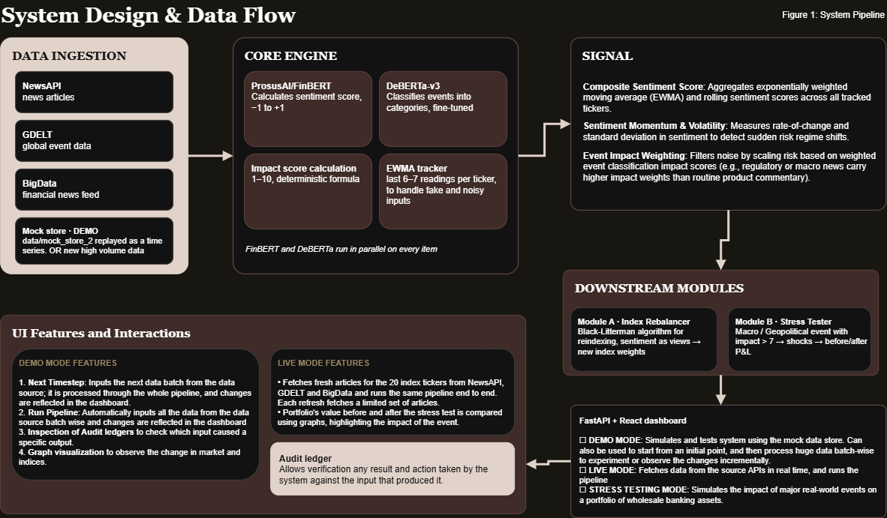

# S&P100|AI-Driven Explainable Risk Engine- S&P Global & Crisil Code to Connect Campus Hackathon 2026
 
**Candidate Name:** Krrish Swarnkar\
**College Email ID:** 112415109@cse.iiitp.ac.in\
**College / Campus:** Indian Institute of Information Technology, Pune\
**Demo Video Link:** 
**Slide Deck Link:** https://docs.google.com/presentation/d/1MNXn83g2X4EZNzPk7pnN4YpO3Rtb_lZi3s5vk1COfYs/edit?usp=sharing


## 1. Project Overview
**Business and Technical Problem**
Financial markets are overwhelmed by high-velocity, unstructured news feeds (such as rate decisions, sanctions, and earnings shocks) that arrive faster than human trading desks can process. Traditional sentiment tools present critical limitations: they produce opaque scores that cannot be traced back to their source, and downstream stress tests are typically conducted manually long after market events occur.

**Solution Approach**
To address these challenges, the system deploys a transformer-powered NLP engine utilizing models like ProsusAI/FinBERT and DeBERTa-v3-base to deliver high-precision sentiment analysis and automated event classification across distinct financial topics. The architecture integrates historical entity data for context-aware impact scoring, combines market equilibrium with subjective views via Black-Litterman re-indexing for optimal fiduciary allocations, and uses a predictive stress tester to simulate macro scenarios.

**Explainable Design and System Highlights**
The platform ensures end-to-end transparency through a deterministic event ledger that binds every signal and weight adjustment to a unique source event ID. Featuring a modular structure to adapt to data and concept drift, the system provides tuneable impact scores, real-time input inspection, and surgical data remediation to purge faulty inputs and streamline analytical workflows.

---

## Repository Structure

```text
.
├── .dockerignore                     # Docker build exclusions
├── .env.example                      # Sample environment variables template
├── .gitignore                        # Git version control exclusions
├── Dockerfile                        # Multi-stage production container build
├── Dockerfile.backend                # Backend service container definition
├── Dockerfile.frontend               # Frontend Nginx container definition
├── Dockerfile.standalone             # Self-contained all-in-one image build
├── docker-compose.yml                # Production multi-service orchestration
├── docker-compose.dev.yml            # Hot-reloading development orchestration
├── LICENSE                           # Project open-source license
├── README.md                         # Project documentation and guide
├── requirements.txt                  # Python core dependencies
│
├── data/                             # News feeds and baseline data
│   ├── FinancialPhraseBank/          # Exploratory baseline dataset (legacy)
│   ├── live_mode_fetched/            # Real-time API response cache (Live Mode)
│   └── mock_store_2/                 # Pre-fetched timestep payloads (Demo Mode)
│
├── docs/                             # Documentation assets
│   ├── architecture.png              # System design & data flow diagram
│   └── prompts/                      # LLM & prompt engineering notes
│
├── frontend/                         # React + Vite interactive dashboard
│   ├── src/                          # Dashboard components (WeightChart, StressTestPanel, etc.)
│   ├── Dockerfile                    # Frontend container build (Vite + Nginx)
│   ├── nginx.conf                    # Nginx reverse proxy configuration
│   ├── package.json                  # Frontend dependencies and npm scripts
│   └── vite.config.js                # Vite build and dev server config
│
├── scripts/                          # Automation and deployment utility scripts
│   ├── build_and_export.bat/.sh      # Container build and offline image exporter
│   ├── import_and_run.sh             # Offline container import and runner
│   └── run_compose.bat/.sh           # One-click Docker Compose launcher
│
└── src/                              # Core Python engine and service modules
    ├── api.py                        # FastAPI REST backend and WebSocket server
    ├── pipeline.py                   # End-to-end execution pipeline coordinator
    ├── risk_engine.py                # NLP sentiment scoring and risk signals engine
    ├── rebalancing_engine.py         # Module A: Black-Litterman portfolio rebalancer
    ├── module_b_stress_test.py       # Module B: Wholesale banking shock engine
    ├── portfolio_data.py             # S&P constituent & wholesale banking holdings
    ├── gen_mock_source.py            # NewsAPI, GDELT & BigData ingest generator
    ├── train_event_classifier_deberta.py  # DeBERTa-v3 20-class model training script
    ├── train_event_classifier_finbert.py  # FinBERT event classification training
    ├── bert.py                       # Baseline exploratory multi-task modeling
    └── output/                       # Generated run outputs, ledgers & model weights
        ├── deberta_event_classifier/ # Fine-tuned DeBERTa model artifacts (Production) ***PUT THE MODEL WEIGHTS FILE FROM DRIVE HERE***
        │   ├── best_model.pt         # Fine-tuned model checkpoint
        │   ├── deberta_event_classifier.pt # Final production PyTorch weights
        │   ├── event_label_mapping.json    # 20 financial event category mapping
        │   ├── history.json          # Training epoch loss & evaluation logs
        │   ├── metrics.json          # Precision, recall, and F1 validation metrics
        │   ├── spm.model             # SentencePiece tokenizer model
        │   ├── tokenizer.json        # Fast tokenizer definition
        │   ├── tokenizer_config.json # Tokenizer parameters and vocab config
        │   └── special_tokens_map.json
        ├── risk_engine_outputs/      # Risk signals, summary reports & JSONL ledger
        ├── rebalancing_outputs/      # Portfolio weights & rebalancing audit trail
        └── stress_test_outputs/      # Module B macro shock simulation results
```

---

## 2. Architecture & Tech Stack

### System Design & Data Flow



### Key Frameworks & Libraries

| Layer | Technology |
|---|---|
| NLP — Sentiment | `ProsusAI/finbert` via HuggingFace Transformers |
| NLP — Event Classification | `microsoft/deberta-v3-base` (fine-tuned on `zeroshot/twitter-financial-news-topic` via HuggingFace, 20 classes)  |
| Portfolio Optimization (Module A) | Black-Litterman model (NumPy/SciPy) |
| Stress Testing (Module B) | Custom shock engine + `yfinance` market anchors |
| API Backend | FastAPI + Uvicorn |
| Frontend | React + Vite, Vanilla CSS, Plotly-style charts |
| ML Framework | PyTorch ≥ 2.0 |
| Data | Pandas, NumPy, SciPy |

---

## 3. Dataset Used

### Training Data (offline — not part of live pipeline)
| Dataset | Purpose | Files |
|---|---|---|
| `zeroshot/twitter-financial-news-topic` (HuggingFace) | Fine-tune DeBERTa event classifier (20 classes) | `src/train_event_classifier_deberta.py` |
| FinancialPhraseBank (`data/FinancialPhraseBank/`) downloaded from Kaggle| Early FinBERT multi-task baseline exploration | `src/bert.py` (**not** in production pipeline) |

> ⚠️ `data/FinancialPhraseBank/`, is **legacy data files** used only during model exploration and fine-tuning/model comparision phase. It are **not referenced** by any production pipeline script.

### Production Data (pipeline)
| Source | Mode | Location | Created by running 
|---|---|---| ----------|
| Pre-fetched NewsAPI + GDELT + BigData JSON payloads | Demo | `data/mock_store_2/` | `src/gen_mock_source.py` |
| Real-time NewsAPI + GDELT + BigData APIs | Live | `data/live_mode_fetched/` | functions resued from `src/gen_mock_source.py`|

### Module B Portfolio
- **Synthetic wholesale banking portfolio** — 10 positions across 4 asset classes (Corporate Term Loans, Corporate Bonds, Interest Rate Derivatives, Sovereign Bonds)
- Total gross book value: **$2,560M**
- **yfinance** anchors (SPY, TLT, HYG, GLD, USO) used to ground market-level price context at runtime

### Assumptions
- Covariance matrix in Module A is synthetically generated via a single-factor market model (NumPy seed 42) for demonstration
- Portfolio positions in Module B use book/face values; MTM for derivatives is represented as net exposure
- Shock percentages are calibrated to historical stressed market moves (2008 GFC, 2022 rate shock, EM crises)

---

## 4. Quickstart & Installation

**Runtime:** Python 3.10+ on Windows / macOS / Linux, or **Docker** (recommended for instant replication).

### Setup


```bash
git clone https://github.com/rkrrish/IIIT_Pune-KrrishSwarnkar-CodeToConnect2026.git
cd IIIT_Pune-KrrishSwarnkar-CodeToConnect2026
```

**Note:** After cloning, extract and put the output weights file from the drive link provided below, into `src/output/deberta_event_classifier/`.

The files  `src/output/deberta_event_classifier/deberta_event_classifier.pt`, `src/output/deberta_event_classifier/best_model.pt` and `src/output/deberta_event_classifier/event_label_mapping.json` are the weights file for the fine-tuned DeBERTa model and they should be placed there. 

Due to storage limitations of GitHUB, I could not upload the model weights files directly, so I have uploaded them on Google Drive and provided the link below. You can download the files from the link and place them in the `src/output/deberta_event_classifier/` directory.

**Link:** https://drive.google.com/drive/folders/1WneWbt0SqSmPzfSOzWgvOabsA2TnCqbj?usp=sharing


#### Method 1: Using Docker
```bash
# Build the frontend static bundle once
cd frontend && npm install && npm run build && cd ..

# Start containers
docker compose up -d


# Open Dashboard: http://localhost:5173 (or http://localhost:80)
# Open API Docs:  http://localhost:8000/docs
```

Or run the one-click scripts in `scripts/`:
- **Windows:** Double-click [`scripts/run_compose.bat`](file:///d:/Dev/projects/python/snp/scripts/run_compose.bat)
- **Linux/macOS:** `bash scripts/run_compose.sh`

---

#### Method 2: Step-by-step Local Run

```bash
# 1. Create & activate environment (skip if you use only base environment or if you are already in the virtual environment)
conda create -n pysnp python=3.10 -y
conda activate pysnp

# 2. Install all dependencies
pip install -r requirements.txt

# 3. Set up API keys (optional — for Live Mode only)
cp .env.example src/.env
# Edit src/.env and add: NEWSAPI_KEY, BIGDATA_KEY

# 4. Run the FastAPI backend
uvicorn src.api:app --host 0.0.0.0 --port 8000 --reload

# 5. Run the frontend (in a second terminal)
cd frontend
npm install
npm run dev
# Open http://localhost:5173
```

**Note**: Make sure that you have the Finetuned DeBERT-a model weights in `src/output/debert_event_classifier`. If not then you can generate this file by running `src/train_event_classifier_deberta.py` in your python environment, otherwise the system will fallback to base models and it may behave different than expected.

### Dashboard workflow
1. Open the dashboard at `http://localhost:5173`
2. **DEMO MODE**: Click **Run Pipeline** or **Next Timestep** to process mock events. This can also be used for processing batch input for huge data when required. Click on **Reset Demo** to reset the system state to default initial values.
3. **LIVE MODE**: Click **Refresh Live Data** to fetch real-time news (requires API keys)
4. **STRESS TEST**: Click the tab, select a scenario or use **Auto-Detect Trigger**, then click **Run Stress Test**

---

## 5. Key Results & Domain Impact

### Prototype Outputs

| Output | Location | Description |
|---|---|---|
| Risk Signals JSON | `src/output/risk_engine_outputs/latest_risk_signals.json` | Full structured signals with sentiment + event + impact |
| Signals Ledger | `src/output/risk_engine_outputs/signals_history_ledger.jsonl` | Append-only stream of all processed signals |
| Risk Summary Report | `src/output/risk_engine_outputs/risk_summary_report.json` | Per-ticker aggregated metrics |
| Rebalance Ledger | `src/output/rebalancing_outputs/rebalance_ledger.jsonl` | Audit trail of all weight changes |
| Latest Weights | `src/output/rebalancing_outputs/latest_weights.json` | Current portfolio weights |
| Stress Test Result | `src/output/stress_test_outputs/latest_stress_result.json` | Latest Module B shock simulation result |

### Domain Impact

**Module A (Index Rebalancer):** Demonstrates that news-driven NLP signals can be systematically integrated into a Black-Litterman optimization to adjust index weights — avoiding the corner solutions of raw mean-variance optimization while staying risk-averse.

**Module B (Stress Testing):** Proves that the same NLP event signals can act as an early-warning system for portfolio stress scenarios. When a `Macro` or `Geopolitical` event exceeds impact score 7/10, the system automatically maps it to a calibrated financial shock scenario and computes portfolio P&L impact across 10 wholesale banking positions — simulating what a risk desk would do manually in hours, done in seconds.

**Business value:** The combined system bridges the gap between unstructured news consumption and quantitative risk management, enabling:
- Real-time tactical rebalancing driven by AI sentiment signals
- Automated stress test triggering from external event intelligence
- Full audit trail from raw text → risk signal → portfolio action

### Model Performance (Event Classifier Training)

| Model | Accuracy | Precision | Recall | F1 |
|---|---|---|---|---|
| FinBERT (baseline) | 0.9128 | 0.8846 | 0.9162 | 0.8972 |
| **DeBERTa-v3 (deployed)** | **0.9298** | **0.9263** | **0.9293** | **0.9269** |

*Fine-tuned on `zeroshot/twitter-financial-news-topic` (20 financial event categories)*
*Training artifacts: `src/output/deberta_event_classifier/`*